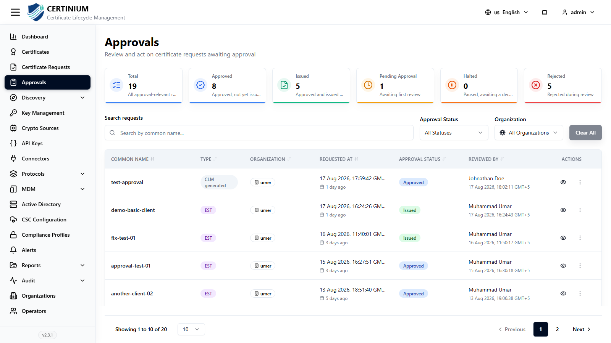

# Approvals

**Approvals** is where administrators review and act on certificate requests that were flagged as **Requires Approval** — from [Certificate Requests](certificate_requests.md), or from a protocol profile ([SCEP](scep_server.md), [EST](est_server.md), [CMP](cmp_server.md)) or [connector](connectors.md) with **Require Manual Approval** enabled.

## Accessing Approvals

From the sidebar, select **Approvals**.

### Approvals overview

Summary cards show the full lifecycle of approval-relevant requests:

- **Total** — all approval-relevant requests.
- **Approved** — approved, not yet issued.
- **Issued** — approved and issued.
- **Pending Approval** — awaiting first review.
- **Halted** — paused, awaiting a decision.
- **Rejected** — rejected during review.

### Search and filter

- **Search requests** — by common name.
- **Approval Status**, **Organization** — narrow the list.
- **Clear All** — resets all filters.

### Approvals list

| Column | Description |
|---|---|
| Common Name | The request's common name. |
| Type | Where the request came from, e.g. `EST`, `SCEP`, or `CLM generated`. |
| Organization | Owning organization. |
| Requested At | When the request was submitted, with a relative "time ago". |
| Approval Status | Approved, Rejected, Discarded, or Pending. |
| Reviewed By | The operator who made the decision, and when. |
| Actions | An eye icon opens the request detail; the **⋮** menu exposes decision actions for requests still awaiting review. |

## Reviewing a request

Click the eye icon on any row to open its detail view, where you can inspect the request's full subject information before deciding. For a request still in **Pending Approval**, use the row's action menu to approve, reject, or halt it. Once a decision is recorded, the **Approval Status** and **Reviewed By** columns update immediately, and — if approved — the request becomes eligible for issuance from [Certificates](certificates.md).

## Notifications

CLM notifies operators by email and in-app when an approval-relevant request changes state:

- **Approvers** (anyone with access to Approvals in the request's organization) are notified when a request enters review — whether it came in manually, via import, or from a protocol profile (SCEP/EST/CMP/ACME) with **Require Manual Approval** enabled.
- **Requesters** are notified when their request is approved, rejected, halted, discarded, or approved but not yet issued. Requests submitted through a protocol don't get an outcome notice, since the protocol client receives its own response.

Each real status change sends at most one notice — re-polling a pending request, or re-submitting `/issue`, doesn't generate duplicates.

In-app notifications appear via the **bell icon** in the top header:

- An unread badge on the bell shows the notification count (capped at "9+").
- Click the bell to open a dropdown listing recent notifications — each shows the request's number/common name, who triggered it, and a relative time. Clicking a notification opens that request's detail here on the Approvals page.
- Use **Mark all as read** in the dropdown to clear the unread badge.

The sidebar's **Approvals** entry also carries its own badge, independent of the bell, showing how many requests are waiting for review.

Email delivery uses the organization's own SMTP [connector](connectors.md), or a shared one, and is sent in the recipient's language where available.
