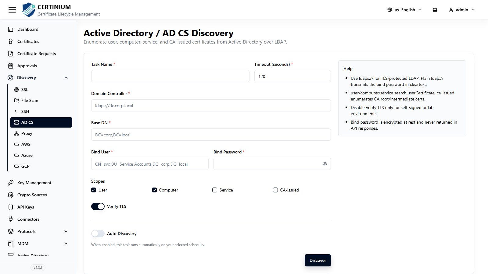
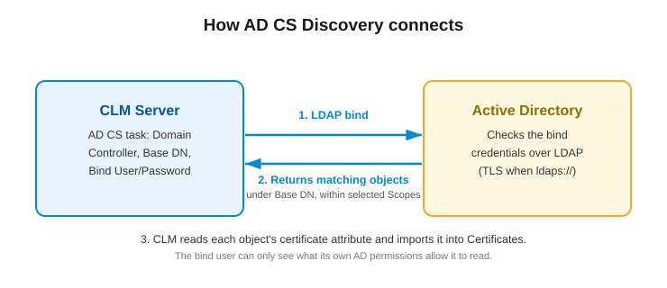

# Active Directory / AD CS Discovery

Enumerates user, computer, service, and CA-issued certificates from Active Directory over LDAP.

From the sidebar, select **Discovery → AD CS**.

- **Task Name***, **Timeout (seconds)***
- **Domain Controller*** — e.g. `ldaps://dc.corp.local`.
- **Base DN*** — e.g. `DC=corp,DC=local`.
- **Bind User***, **Bind Password***
- **Use StartTLS** — required when **Domain Controller** uses plain `ldap://` and you're providing a **Bind Password**: without it, the bind password is refused and only an unauthenticated/anonymous bind over `ldap://` is possible. Not needed with `ldaps://`, which is already encrypted.
- **Scopes** — which certificate sources to enumerate: **User**, **Computer**, **Service**, **CA-issued** (root/intermediate CA certificates).
- **Verify TLS**, **Auto Discovery**

Click **Discover** to run the scan immediately. Certificates found are imported into [Certificates](certificates.md) tagged `DISCOVERY IMPORT`, and the run is logged to [Audit → Discovery Logs](audit.md).

!!! note
    This is distinct from the [Active Directory](active_directory.md) page, which shows certificates CLM has *published* to AD/LDAP identities rather than certificates *discovered* from AD.

## How it works

1. CLM binds to **Domain Controller** using **Bind User**/**Bind Password** — over TLS if the URL is `ldaps://`, or upgraded with StartTLS first if **Use StartTLS** is on.
2. It searches under **Base DN** for the object types selected in **Scopes**, and reads each matching object's certificate attribute.
3. Found certificates are imported into [Certificates](certificates.md).

## Permissions required

Two different permissions matter here, and both have to be right for a scan to actually bring certificates into CLM:

**1. The CLM role permission — lets a user work with the task in the UI.** Like every discovery type, AD CS Discovery is governed by the **Discovery** module permissions (see [Roles](roles.md)):

- **View Discovery** — see existing AD CS tasks and their results.
- **Modify Discovery** — create, edit, run, or delete an AD CS task. Without it, the **Discover** button for creating a new task isn't shown at all.

**2. The bind account's own AD permissions — lets CLM actually read the objects.** Holding *Modify Discovery* only lets you ask CLM to query AD; it does not grant any directory access. **Bind User** must be a real AD account allowed to bind to the directory and with read access to the certificate-bearing attributes (e.g. `userCertificate`, `cACertificate`) on whatever objects fall under **Base DN** and the selected **Scopes** — a bind that succeeds but lacks read rights on those attributes will simply return nothing for that object, not an error.
