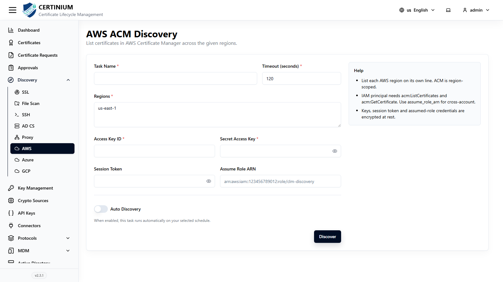
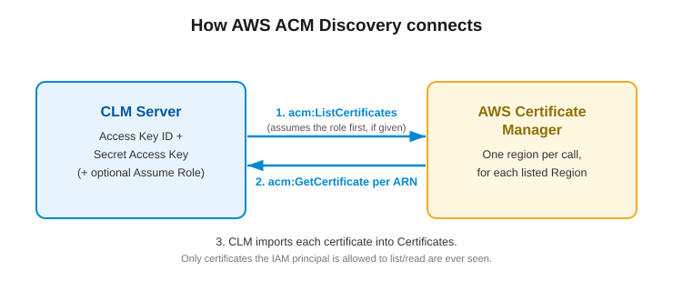

# AWS ACM Discovery

Lists certificates in AWS Certificate Manager across the given regions.

From the sidebar, select **Discovery → AWS**.

- **Task Name***, **Timeout (seconds)***, **Regions*** (one per line)
- **Access Key ID***, **Secret Access Key***, optional **Session Token**, optional **Assume Role ARN** for cross-account access.
- The IAM principal needs `acm:ListCertificates` and `acm:GetCertificate`. Credentials are encrypted at rest.
- **Auto Discovery**

Click **Discover** to run the scan immediately. Certificates found are imported into [Certificates](certificates.md) tagged `DISCOVERY IMPORT`, and the run is logged to [Audit → Discovery Logs](audit.md).

## How it works

1. CLM authenticates to AWS with **Access Key ID**/**Secret Access Key** (and **Session Token**, if given); if **Assume Role ARN** is set, it assumes that role first and uses the resulting temporary credentials instead.
2. For each listed **Region**, it calls `acm:ListCertificates`, then `acm:GetCertificate` for each certificate ARN returned.
3. Certificates are imported into [Certificates](certificates.md).

## Permissions required

Two different permissions matter here, and both have to be right for a scan to actually bring certificates into CLM:

**1. The CLM role permission — lets a user work with the task in the UI.** Like every discovery type, AWS ACM Discovery is governed by the **Discovery** module permissions (see [Roles](roles.md)):

- **View Discovery** — see existing AWS tasks and their results.
- **Modify Discovery** — create, edit, run, or delete an AWS task. Without it, the **Discover** button for creating a new task isn't shown at all.

**2. The IAM principal's own AWS permissions — lets CLM actually read the certificates.** Holding *Modify Discovery* only lets you ask CLM to call AWS; it does not grant any AWS access. The credentials (or, with **Assume Role ARN**, the role being assumed) need `acm:ListCertificates` and `acm:GetCertificate` in every listed **Region** — without them, AWS returns an authorization error for that region rather than an empty list.
