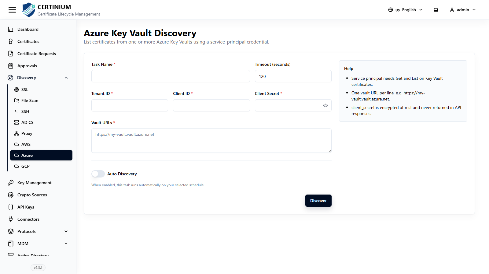
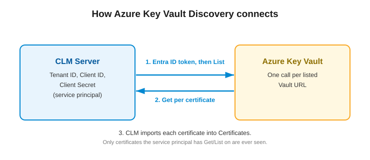

# Azure Key Vault Discovery

Lists certificates from one or more Azure Key Vaults using a service-principal credential.

From the sidebar, select **Discovery → Azure**.

- **Task Name***, **Timeout (seconds)***
- **Tenant ID***, **Client ID***, **Client Secret***
- **Vault URLs*** — one per line, e.g. `https://my-vault.vault.azure.net`.
- The service principal needs `Get` and `List` on Key Vault certificates.
- **Auto Discovery**

Click **Discover** to run the scan immediately. Certificates found are imported into [Certificates](certificates.md) tagged `DISCOVERY IMPORT`, and the run is logged to [Audit → Discovery Logs](audit.md).

## How it works

1. CLM authenticates to Microsoft Entra ID as the service principal (**Tenant ID**/**Client ID**/**Client Secret**) to get an access token.
2. For each listed **Vault URL**, it lists the certificates in that vault, then fetches each one.
3. Certificates are imported into [Certificates](certificates.md).

## Permissions required

Two different permissions matter here, and both have to be right for a scan to actually bring certificates into CLM:

**1. The CLM role permission — lets a user work with the task in the UI.** Like every discovery type, Azure Key Vault Discovery is governed by the **Discovery** module permissions (see [Roles](roles.md)):

- **View Discovery** — see existing Azure tasks and their results.
- **Modify Discovery** — create, edit, run, or delete an Azure task. Without it, the **Discover** button for creating a new task isn't shown at all.

**2. The service principal's own Azure permissions — lets CLM actually read the certificates.** Holding *Modify Discovery* only lets you ask CLM to call Azure; it does not grant any Azure access. The service principal needs the **Get** and **List** certificate permissions (via an access policy or RBAC role) on each **Vault URL** — without them, Azure returns an authorization error for that vault rather than an empty list.
