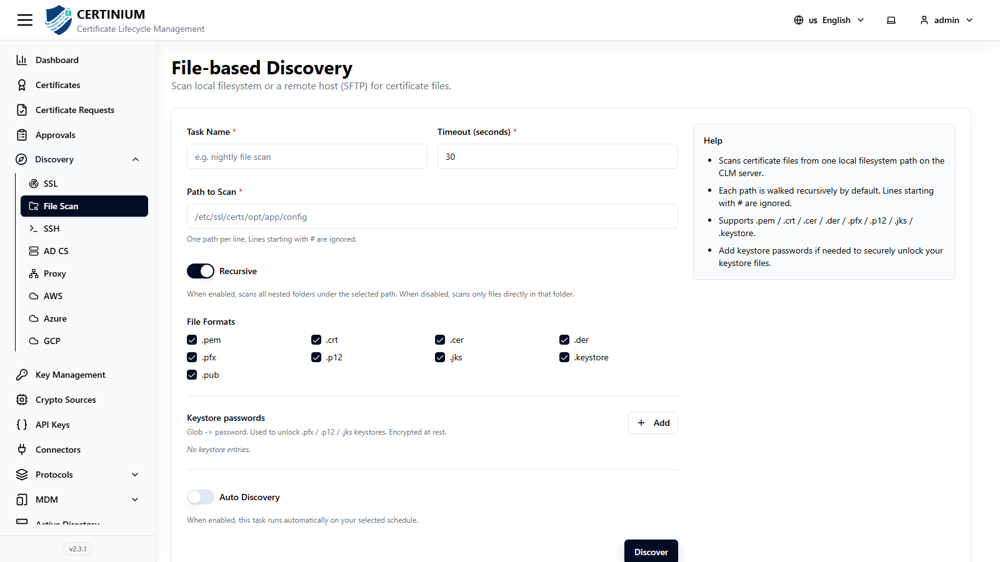
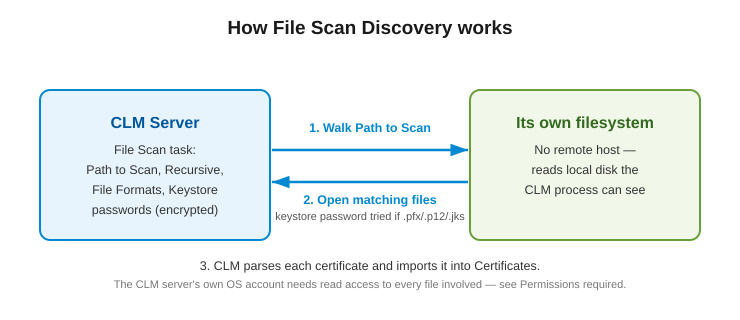

# File Scan (File-based Discovery)

Scans the local filesystem on the CLM server for certificate files.

From the sidebar, select **Discovery → File Scan**.

- **Task Name***, **Timeout (seconds)***
- **Path to Scan*** — a single local filesystem path on the CLM server (not a list — one path per task).
- **Recursive** — when on, scans every nested folder under that path; when off, scans only files directly inside it.
- **File Formats** — checklist of extensions to include: `.pem`, `.crt`, `.cer`, `.der`, `.pfx`, `.p12`, `.jks`, `.keystore`, `.pub`.
- **Keystore passwords** — add rows pairing a **File Format** glob pattern (e.g. `*.pfx`) with a **Set Password**, used to unlock matching `.pfx`/`.p12`/`.jks` keystores found during the scan. A file's path is matched against each pattern in turn; passwords are encrypted at rest.
- **Auto Discovery**

Click **Discover** to run the scan immediately. Certificates found are imported into [Certificates](certificates.md) tagged `DISCOVERY IMPORT`, and the run is logged to [Audit → Discovery Logs](audit.md).

## How it works

CLM walks the given **Path to Scan** directly on its own server (there's no remote host or credentials involved — only a path that exists on the CLM server's filesystem):

1. If **Recursive** is on, every subfolder under the path is walked too; otherwise only files directly in that folder are considered.
2. Each file matching one of the checked **File Formats** is opened and parsed as a certificate or keystore.
3. For a `.pfx`, `.p12`, or `.jks` file, CLM tries the **Keystore passwords** rows in order, using the first whose glob pattern matches the file's path or name, to unlock it.
4. Certificates extracted are imported into [Certificates](certificates.md). If the path doesn't exist, or no matching certificate files are found under it, the task completes with an error explaining why instead of silently finding nothing.

## Permissions required

Two different permissions matter here, and both have to be right for a scan to actually bring certificates into CLM:

**1. The CLM role permission — lets a user work with the task in the UI.** Like every discovery type, File Scan is governed by the **Discovery** module permissions (see [Roles](roles.md)):

- **View Discovery** — see existing file-scan tasks and their results.
- **Modify Discovery** — create, edit, run, or delete a file-scan task. Without it, the **Discover** button for creating a new task isn't shown at all.

**2. The OS filesystem permission — lets CLM itself actually read the files.** Holding *Modify Discovery* only lets you ask CLM to scan a path; it does not change what CLM is allowed to read on disk. The account the CLM server process runs as needs its own OS-level read permission (and execute/traverse permission on every folder in between) on **Path to Scan** and everything under it:

- If CLM can't even list the top-level path, the task fails outright with that error.
- With **Recursive** on, a subfolder CLM can't traverse is silently skipped — no error, it's just treated as if nothing is there.
- A file CLM can list but can't open (e.g. read-only to another OS user) shows up as a per-file error in that run's results, rather than being silently skipped.

So before relying on a File Scan task, make sure the CLM server's OS account has read access to the certificates you expect it to find — a correct **Modify Discovery** role alone won't make an unreadable file appear.
