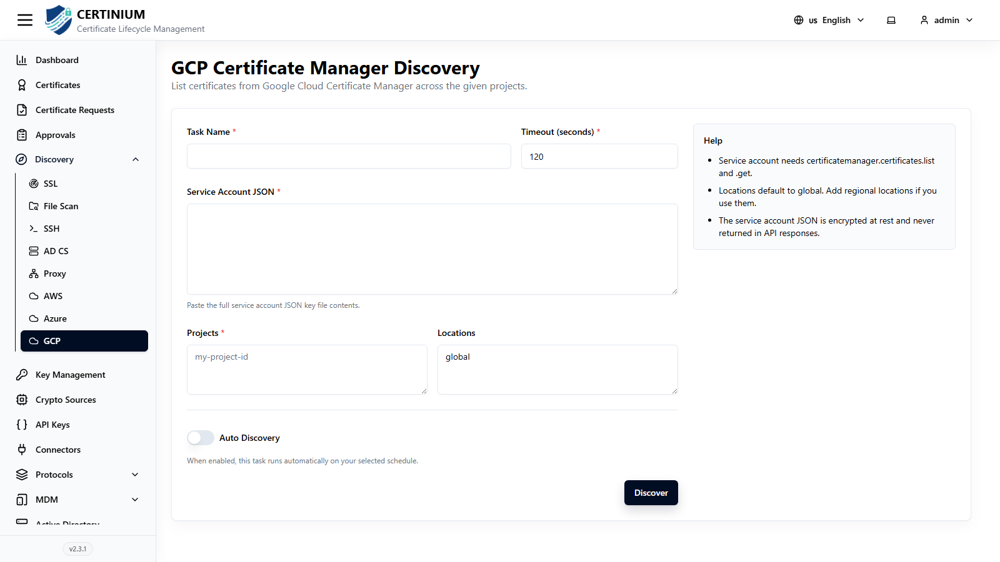
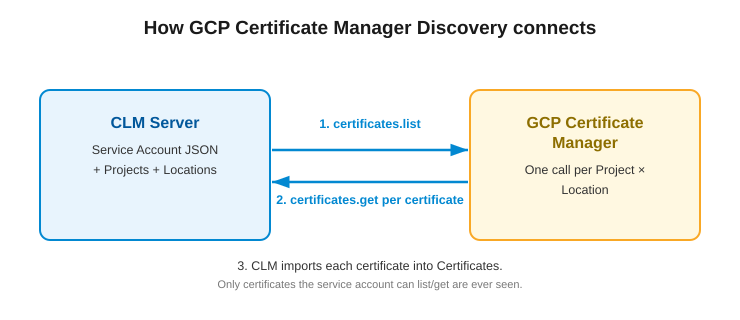

# GCP Certificate Manager Discovery

Lists certificates from Google Cloud Certificate Manager across the given projects.

From the sidebar, select **Discovery → GCP**.

- **Task Name***, **Timeout (seconds)***
- **Service Account JSON*** — paste the full service account JSON key file contents.
- **Projects*** — one project ID per line.
- **Locations** — defaults to `global`; add regional locations if you use them.
- The service account needs `certificatemanager.certificates.list` and `.get`.
- **Auto Discovery**

Click **Discover** to run the scan immediately. Certificates found are imported into [Certificates](certificates.md) tagged `DISCOVERY IMPORT`, and the run is logged to [Audit → Discovery Logs](audit.md).

## How it works

1. CLM authenticates to Google Cloud using **Service Account JSON**.
2. For each combination of **Projects** and **Locations**, it calls `certificates.list`, then `certificates.get` for each certificate returned.
3. Certificates are imported into [Certificates](certificates.md).

## Permissions required

Two different permissions matter here, and both have to be right for a scan to actually bring certificates into CLM:

**1. The CLM role permission — lets a user work with the task in the UI.** Like every discovery type, GCP Certificate Manager Discovery is governed by the **Discovery** module permissions (see [Roles](roles.md)):

- **View Discovery** — see existing GCP tasks and their results.
- **Modify Discovery** — create, edit, run, or delete a GCP task. Without it, the **Discover** button for creating a new task isn't shown at all.

**2. The service account's own GCP IAM permissions — lets CLM actually read the certificates.** Holding *Modify Discovery* only lets you ask CLM to call GCP; it does not grant any GCP access. The service account needs `certificatemanager.certificates.list` and `certificatemanager.certificates.get` on each listed **Project**/**Location** — without them, GCP returns a permission-denied error for that project rather than an empty list.
