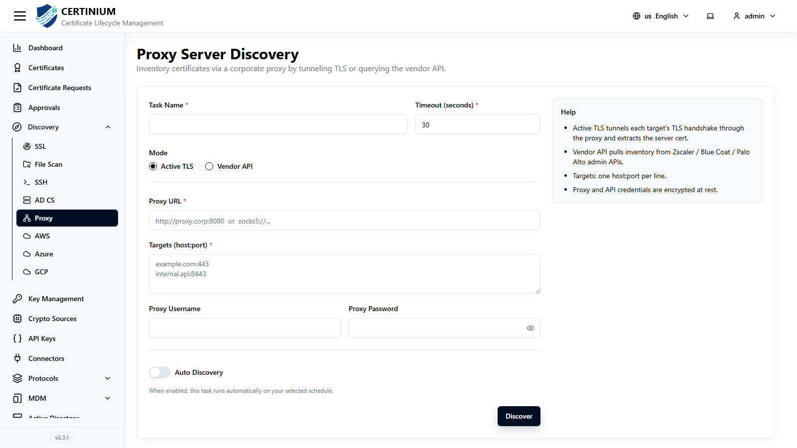
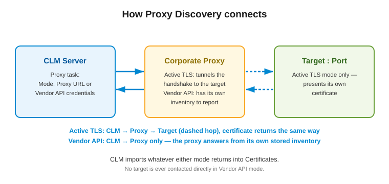

# Proxy Server Discovery

Inventories certificates seen via a corporate proxy, either by tunneling a TLS handshake through it or by querying the proxy vendor's own API.

From the sidebar, select **Discovery → Proxy**.

- **Task Name***, **Timeout (seconds)***
- **Mode** — choose one:
    - **Active TLS** — tunnels each target's TLS handshake through the proxy and reads the certificate the real target presents.
        - **Proxy URL***, **Targets (host:port)*** (one per line), **Proxy Username**, **Proxy Password** (if the proxy itself requires authentication to tunnel through).
    - **Vendor API** — pulls a certificate inventory straight from the proxy vendor's own admin API, without contacting any target.
        - **Vendor*** — Zscaler, Blue Coat, or Palo Alto.
        - **API Base URL***, plus either an **API Token** or an **API Username**/**API Password**, depending on what that vendor's API accepts.
- **Auto Discovery**

Click **Discover** to run the scan immediately. Certificates found are imported into [Certificates](certificates.md) tagged `DISCOVERY IMPORT`, and the run is logged to [Audit → Discovery Logs](audit.md).

## How it works

The two modes reach certificates in different ways:

- **Active TLS** — for each entry in **Targets**, CLM connects to **Proxy URL** (authenticating with **Proxy Username**/**Proxy Password** if given), asks it to tunnel a TLS handshake to that target, and reads the certificate the target presents at the far end — the same thing [SSL Discovery](discovery_ssl.md#how-it-works) does, just routed through the proxy instead of connecting directly.
- **Vendor API** — CLM calls **API Base URL** using the credentials you gave (token, or username/password) and asks that vendor's own API for its certificate inventory. No target hosts are contacted directly; you get back whatever the proxy vendor already knows about.

Either way, certificates found are imported into [Certificates](certificates.md).

## Permissions required

Two different permissions matter here, and both have to be right for a scan to actually bring certificates into CLM:

**1. The CLM role permission — lets a user work with the task in the UI.** Like every discovery type, Proxy Discovery is governed by the **Discovery** module permissions (see [Roles](roles.md)):

- **View Discovery** — see existing proxy tasks and their results.
- **Modify Discovery** — create, edit, run, or delete a proxy task. Without it, the **Discover** button for creating a new task isn't shown at all.

**2. Access on the proxy/vendor side — lets CLM actually fetch anything.** Holding *Modify Discovery* only lets you ask CLM to make the call; it does not grant any access on the proxy itself:

- **Active TLS** — the proxy must allow tunneling to the given **Targets**, and **Proxy Username**/**Proxy Password** (when the proxy requires them) must be a valid account permitted to use the proxy for that traffic.
- **Vendor API** — the API Token, or API Username/Password, must belong to an account on that vendor's platform with read access to its certificate inventory. An account that can authenticate but lacks that read scope will get an authorization error back from the vendor rather than an empty result.
