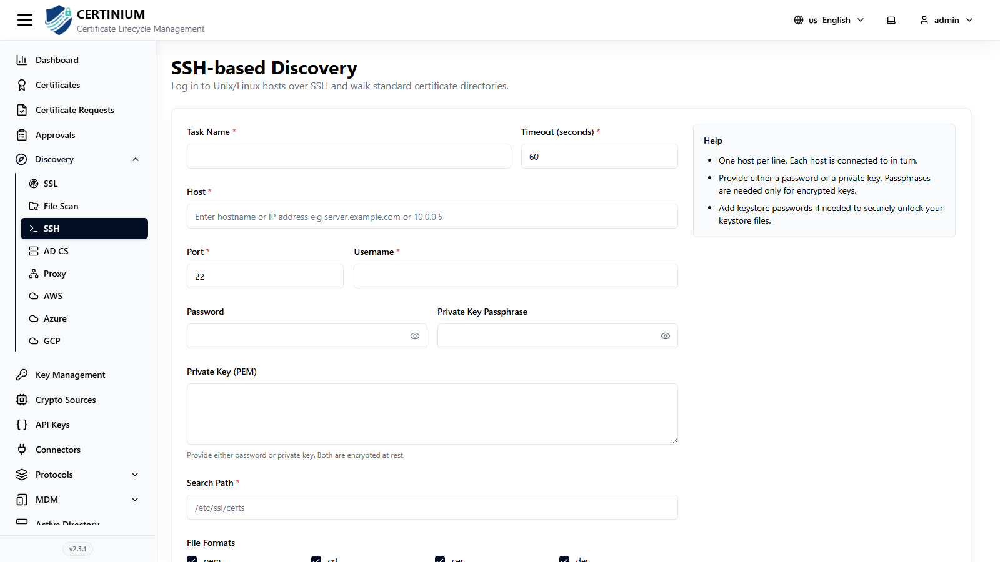
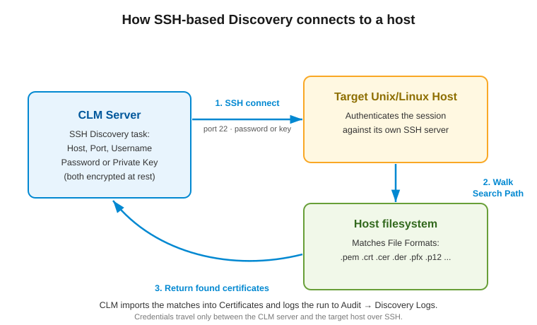

# SSH-based Discovery

Logs in to Unix/Linux hosts over SSH and walks standard certificate directories.

From the sidebar, select **Discovery → SSH**.

- **Task Name***, **Timeout (seconds)***
- **Host***, **Port***, **Username***
- **Password** or **Private Key (PEM)** (with optional **Private Key Passphrase**) — provide one of the two; both are encrypted at rest.
- **Search Path***, **File Formats**
- **Auto Discovery**

Click **Discover** to run the scan immediately. Certificates found are imported into [Certificates](certificates.md) tagged `DISCOVERY IMPORT`, and the run is logged to [Audit → Discovery Logs](audit.md).

## How it works

1. CLM opens an SSH session to the target using **Host**/**Port**/**Username** and either the **Password** or **Private Key**, authenticating against the host's own SSH server.
2. It walks **Search Path** on that host, looking for files matching **File Formats**.
3. Matching certificates are imported into [Certificates](certificates.md).

## Permissions required

Two different permissions matter here, and both have to be right for a scan to actually bring certificates into CLM:

**1. The CLM role permission — lets a user work with the task in the UI.** Like every discovery type, SSH Discovery is governed by the **Discovery** module permissions (see [Roles](roles.md)):

- **View Discovery** — see existing SSH tasks and their results.
- **Modify Discovery** — create, edit, run, or delete an SSH task. Without it, the **Discover** button for creating a new task isn't shown at all.

**2. The target host's own SSH access — lets CLM actually read the files.** Holding *Modify Discovery* only lets you ask CLM to connect; it does not grant any access on the remote machine. The **Username** and **Password**/**Private Key** you provide must belong to an account on the target host that is both allowed to log in over SSH and has OS-level read (and traverse) permission on **Search Path** and everything under it — otherwise the connection succeeds but the walk finds nothing, or fails partway with a permission error for the files it can't open.
