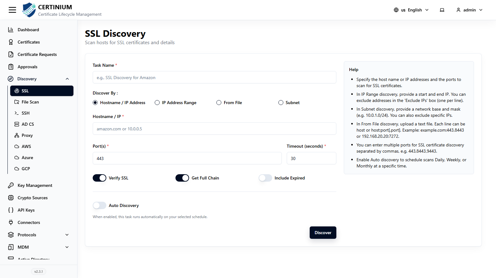
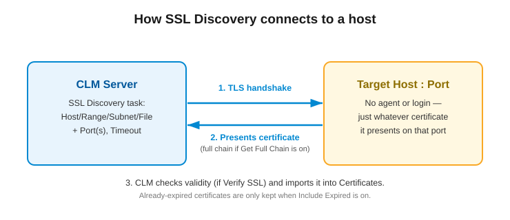

# SSL Discovery

Scans hosts for SSL/TLS certificates presented on their listening ports.

From the sidebar, select **Discovery → SSL**.

- **Task Name***, **Port(s)***, **Timeout (seconds)***
- **Discover By** — choose one: **Hostname / IP Address**, **IP Address Range**, **From File**, or **Subnet** (each explained below).
- **Verify SSL**, **Get Full Chain**, **Include Expired** — toggles controlling how the scan validates and what it captures.
- **Auto Discovery** — run on a recurring schedule.

Click **Discover** to run the scan immediately. Certificates found are imported into [Certificates](certificates.md) tagged `DISCOVERY IMPORT`, and the run is logged to [Audit → Discovery Logs](audit.md).

## Discover By options

Every task scans a set of (host, port) targets on the given **Port(s)** (default 443 if none are given). The four **Discover By** methods are just different ways of building that target list — the TLS handshake described in [How it works](#how-it-works) below is identical for all of them. Across every method, the total number of (host, port) targets in a single task is capped at **65,536**; split a very large range or subnet into smaller tasks if you hit that limit.

### Hostname / IP Address

Targets a single host or IP address, scanned on each of the given ports. Use this for a one-off check of a specific server.

### IP Address Range

Scans every address between a **Start IP** and **End IP** (inclusive) on each of the given ports — useful for a contiguous block of hosts that doesn't line up on a subnet boundary.

- **Exclude IPs** — addresses to skip within that range (e.g. a gateway or a host you know is out of scope), one per line.
- The number of targets is *(addresses in range − exclusions) × ports*; keep it under the 65,536 cap.

### From File

Uploads a **.txt** or **.csv** file (up to 1 MB) listing targets, one per line:

- A bare host or IP — scanned on the task's **Port(s)**.
- `host:port` or `host:port1,port2` — overrides the ports for that line only.
- Lines starting with `#` are treated as comments and ignored.

This is the most flexible method when your targets don't form a clean range or subnet — e.g. a mixed list pulled from inventory or a CMDB export.

### Subnet

Scans one or more networks given in CIDR notation (e.g. `10.0.0.0/24`), one per line — a single task can cover several subnets at once. CLM scans every usable host address in each network on each of the given ports; the network and broadcast addresses are skipped automatically for IPv4 subnets of /30 or larger.

- **Exclude IPs** — same as for IP Address Range, addresses to skip across any of the listed subnets.
- The combined target count across all subnets (minus exclusions, × ports) is still capped at 65,536.

## How it works

For each target and port, CLM performs a plain TLS handshake — no credentials or agent on the target host are needed, since it only reads whatever certificate the service already presents on that port:

1. CLM opens a TLS connection to the host on each of the given **Port(s)**.
2. The target presents its certificate — the full chain if **Get Full Chain** is on, otherwise just the leaf certificate.
3. CLM checks the certificate's validity when **Verify SSL** is on, and imports it into [Certificates](certificates.md). An already-expired certificate is only kept when **Include Expired** is on.

## Permissions required

SSL Discovery is governed by the **Discovery** module permissions (see [Roles](roles.md)):

- **View Discovery** — see existing SSL tasks and their results.
- **Modify Discovery** — create, edit, run, or delete an SSL task. Without it, the **Discover** button for creating a new task isn't shown at all.

No credentials on the target are needed — the TLS handshake only reads whatever certificate the service already presents publicly on that port, so there's no OS- or network-level access to request beyond CLM being able to reach the host and port over the network (firewalls/security groups permitting).
