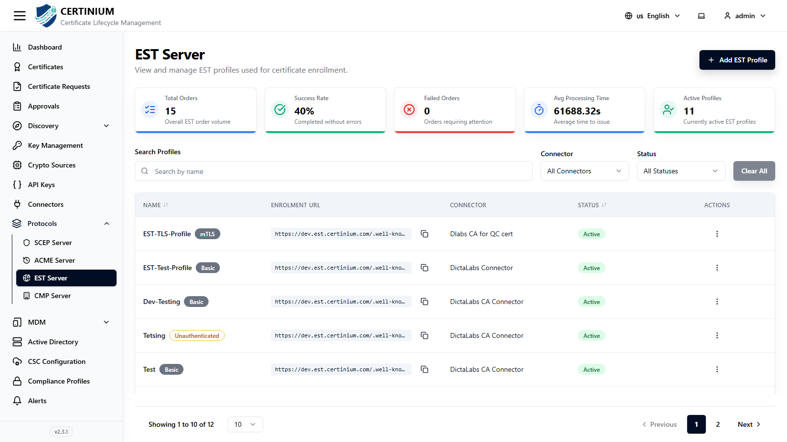
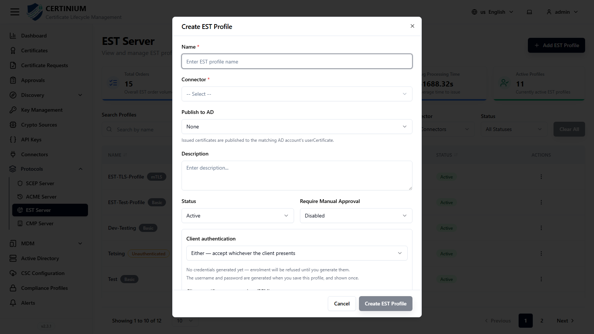

# EST Server

**EST** (Enrollment over Secure Transport) profiles let clients enroll for certificates over HTTPS, optionally using mutual TLS for client authentication.

## Accessing EST Server

From the sidebar, select **Protocols → EST Server**.

### EST Server overview

Summary cards show **Total Orders**, **Success Rate**, **Active Orders**, **Failed Orders**, **Avg Processing** time, and **Active Accounts**.

### Search and filter

- **Search** — by name or keyword.
- **Connectors**, **Status** — narrow the list.
- **Clear All** — resets all filters.

### EST profiles list

| Column | Description |
|---|---|
| Name | Profile name. |
| Enrolment URL | The EST enrollment endpoint clients connect to. |
| Connector | The [connector](connectors.md)/CA backing this profile. |
| Status | Active or Inactive. |
| Actions | View, edit, or delete. |

## Creating a new EST profile

1. Click **Add EST Profile** (top right).
2. Fill in the form:

    

    - **Name*** — the EST profile name.
    - **Connector***
    - **Publish to AD** — optionally publish issued certificates to Active Directory (see [Active Directory](active_directory.md)).
    - **Description**
    - **Status** — Active or Inactive.
    - **Require Manual Approval** — route enrollments through [Approvals](approvals.md).
    - **Client authentication** — how EST authenticates enrolling clients:
        - **HTTP Basic credentials**
        - **TLS client certificate**
        - **Either — accept whichever the client presents**
        - **Both — require credentials and a certificate**
        - **None** — only offered when editing an existing profile that is already set to None; it cannot be selected on a new profile or re-selected once a profile has been switched away from it. A profile left on None shows a warning that EST refuses every enrollment on it (403) until an authentication mode is chosen and saved.
    - **Client certificate trust anchor (PEM)** — shown when a certificate-based authentication mode is used. Either select **Trust anchor from CA connector** (the connector's CA chain is fetched and stored as the trust anchor on save) or paste PEM certificate(s) directly — a pasted PEM takes precedence over the connector's chain.

3. Click **Create EST Profile** to save.

!!! note
    HTTPS enforcement, refusal of unverifiable client identity, and the authentication failure lockout are fixed security behavior and are no longer configurable — there is no environment or settings toggle for them.
