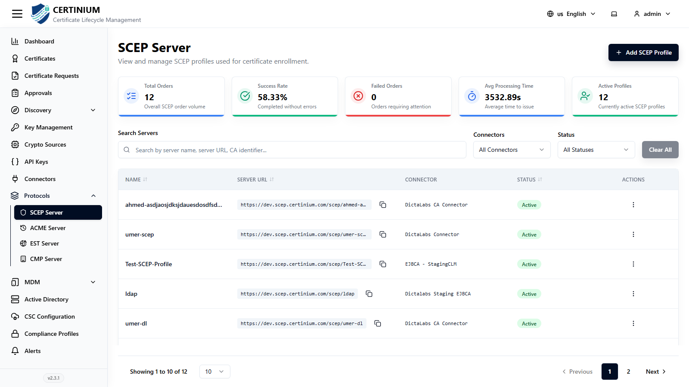
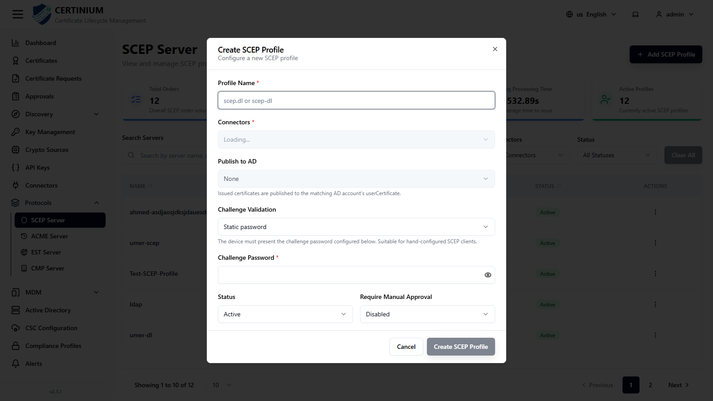

# SCEP Server

**SCEP** (Simple Certificate Enrollment Protocol) profiles let clients and devices enroll for certificates automatically using a shared challenge password.

## Accessing SCEP Server

From the sidebar, select **Protocols → SCEP Server**.

### SCEP Server overview

Summary cards show **Total Orders**, **Success Rate**, **Active Failed Orders**, **Average Processing** time, and **Active Accounts**.

### Search and filter

- **Search** — by name or keyword.
- **Connectors**, **Status** — narrow the list.
- **Clear All** — resets all filters.

### SCEP profiles list

| Column | Description |
|---|---|
| Name | Profile name. |
| Server URL | The SCEP enrollment endpoint clients connect to. |
| Connector | The [connector](connectors.md)/CA backing this profile. |
| Status | Active or Inactive. |
| Actions | View, edit, delete, **One-time passwords** (dynamic challenge profiles only), **RA certificate**. |

## Creating a new SCEP profile

1. Click **Add SCEP Profile** (top right).
2. Fill in the form:

    

    - **Profile Name*** — e.g. `scep.dl` or `scep-dl`.
    - **Connectors***
    - **Publish to AD** — optionally publish issued certificates to the matching Active Directory identity (see [Active Directory](active_directory.md)).
    - **Challenge Validation** — how enrolling clients are authenticated:
        - **No challenge** — any client that can reach the endpoint can enroll. The form shows a warning and recommends enabling **Require Manual Approval** when this is selected; avoid it in production.
        - **Static password** — reveals a **Challenge Password*** field; clients present this shared secret to enroll. Use **Change Password**/**Keep Password** to update or retain it on an existing profile.
        - **Validated by Microsoft Intune** — reveals an **Intune Connector** dropdown (or **Automatic**, which uses the tenant's active Intune connector). The selected connector's Entra app needs the SCEP challenge validation permission.
        - **One-time passwords** — each enrollment consumes a single-use challenge password that an administrator generates in advance (see below).
    - **Status** — Active or Inactive.
    - **Require Manual Approval** — route enrollments through [Approvals](approvals.md) before issuance.

3. Click **Create SCEP Profile** to save.

## One-time challenge passwords

For profiles set to **Challenge Validation → One-time passwords**, open the profile's **⋮** menu and choose **One-time passwords**:

1. In the **Generate passwords** panel, set **Number of passwords** (1–100) and **Valid for (hours)** (1–2160), and optionally a **Label**.
2. Click **Generate**. The new passwords are shown once in a **New one-time passwords** dialog — copy them before closing, as they cannot be retrieved again (only a digest is stored).
3. The dialog's table lists previously generated passwords with **Label**, **State** (Active, Used, Expired, Revoked), **Created**, **Expires**, and **Used** columns. Use the row's **Revoke** action to invalidate a password before it's used.

## RA certificate

Every SCEP profile has an RA (Registration Authority) certificate used to sign and decrypt enrollment traffic. Open a profile's **⋮** menu and choose **RA certificate** to:

- View its **Subject**, **Serial number**, validity window (with a days-remaining or "Expires soon" badge), and SHA-256/SHA-1 fingerprints for out-of-band verification by clients.
- **Download certificate (.pem)**.
- **Rotate RA certificate** (requires manage permission) — prompts for an **Overlap (days)** value (0–90, default 30). During the overlap period the previous RA key continues to decrypt requests encrypted under it, so in-flight enrollments aren't disrupted while clients pick up the new certificate.
